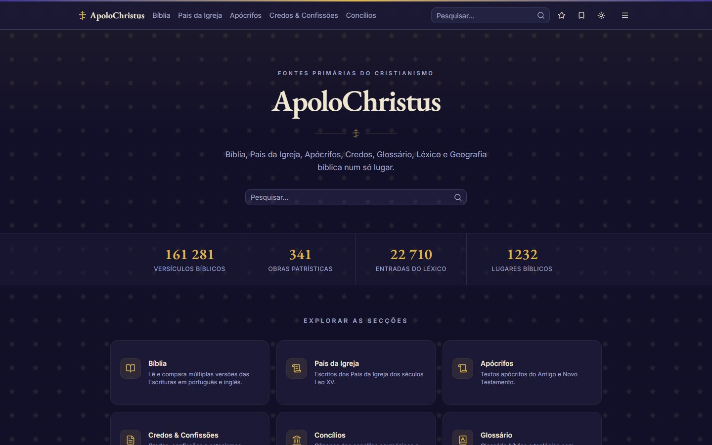
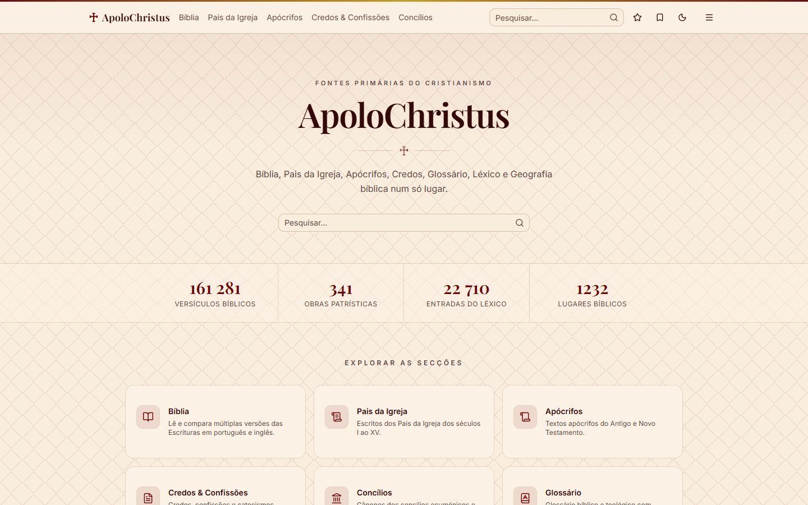
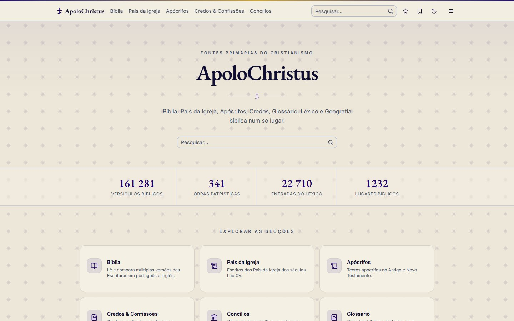
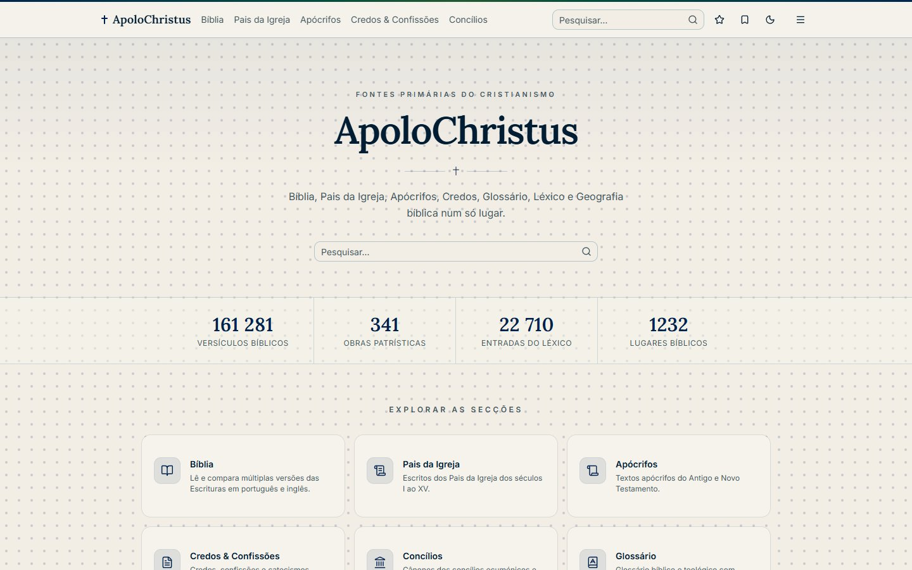
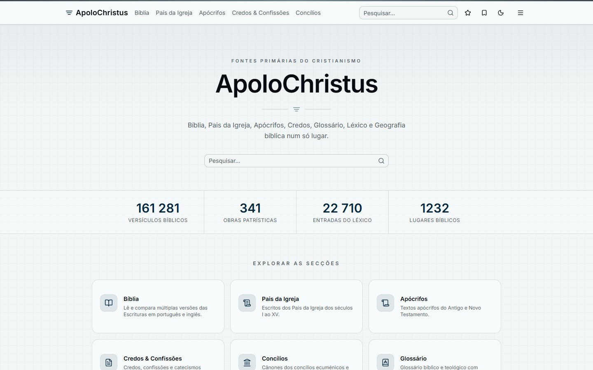
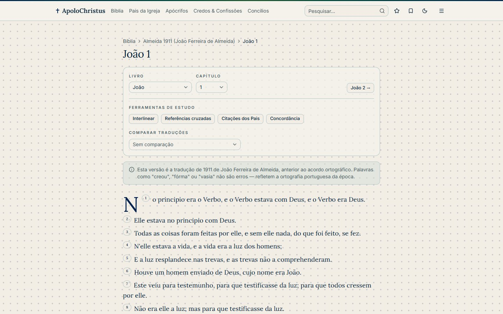
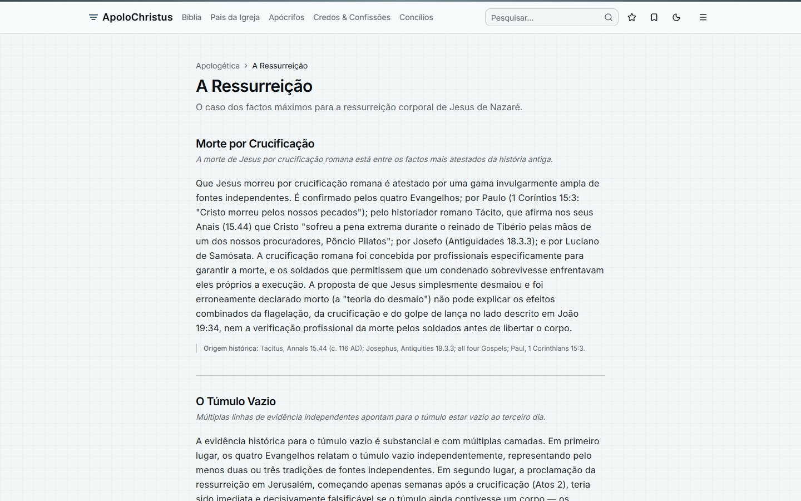
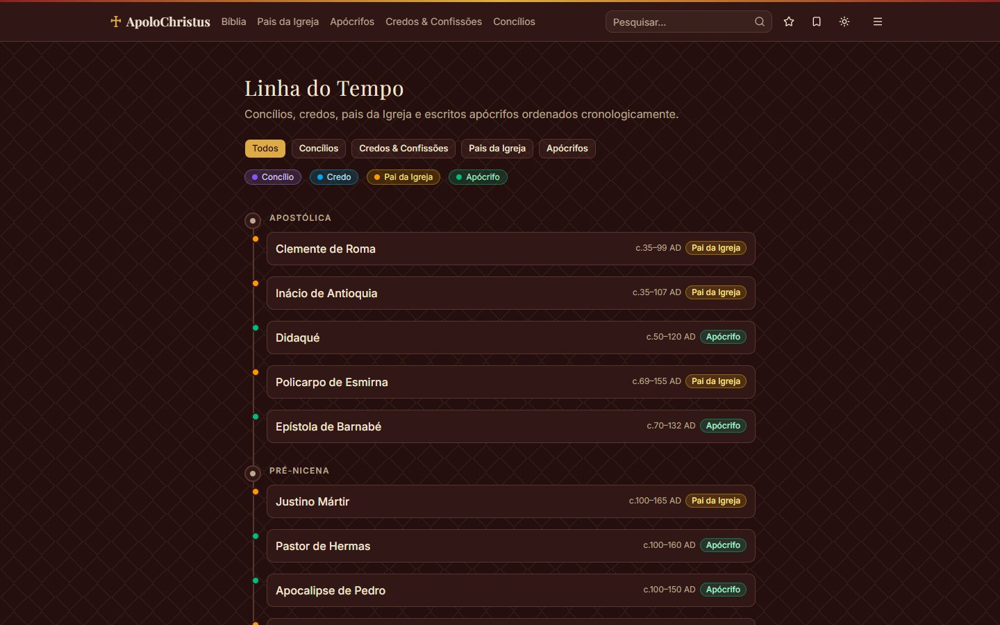

# ApoloChristus

**Primary sources of Christianity in one place** — an open, bilingual (PT/EN) web app that brings together the Bible, the Church Fathers, apocryphal texts, creeds, councils, a Strong's lexicon, biblical geography and structured apologetics arguments, all searchable from a single interface.

ApoloChristus é uma aplicação web aberta e bilingue (português e inglês) que reúne fontes primárias do Cristianismo — Bíblia, Pais da Igreja, apócrifos, credos e confissões, concílios, léxico de Strong, geografia bíblica e apologética — numa única plataforma pesquisável.



<table>
  <tr>
    <td></td>
    <td></td>
  </tr>
  <tr>
    <td></td>
    <td></td>
  </tr>
</table>

<table>
  <tr>
    <td></td>
    <td></td>
  </tr>
  <tr>
    <td colspan="2"></td>
  </tr>
</table>

## Porquê

Quem estuda Cristianismo online enfrenta três problemas:

1. **Onde procurar** — a Bíblia está num site, os Pais da Igreja noutro, os credos noutro.
2. **O que procurar** — não há pesquisa cruzada entre fontes (a mesma passagem no texto bíblico, num comentário patrístico e num credo).
3. **É fiável?** — raramente se indica a fonte, a licença ou a qualidade da tradução.

O ApoloChristus responde com fontes primárias organizadas, pesquisa unificada e **atribuição de fonte e licença em cada página**.

## Funcionalidades

- **Bíblia** — 6 versões (PT, EN, grego, hebraico), leitor com interlinear, referências cruzadas, citações dos Pais da Igreja, concordância e comparação paralela de traduções.
- **Pais da Igreja** — 65 autores e mais de 340 obras (séc. I–XV), navegáveis por período, autor e obra.
- **Apócrifos, credos e concílios** — textos e cânones históricos, com tradução portuguesa quando existe uma fonte fiável (caso contrário, mostra o inglês).
- **Léxico de Strong, glossário e geografia** — com mapa interativo e níveis de confiança na identificação dos locais.
- **Apologética** — argumentos estruturados (premissas e conclusão) sobre a existência de Deus, a fiabilidade dos Evangelhos e a Ressurreição.
- **Linha do tempo** — concílios, credos, Pais da Igreja e apócrifos por época.
- **Pesquisa global** e por secção, favoritos e posição de leitura guardados localmente (sem contas de utilizador).
- **Quatro temas visuais** (católico, ortodoxo, protestante, agnóstico), cada um com cores, padrões de fundo, divisor ornamental e tipografia próprios — e uma variante **escura** de cada um.

## Stack

| Camada | Tecnologia |
|--------|------------|
| Frontend | React, Vite, TypeScript, Tailwind CSS v4, shadcn/ui |
| Dados e estado | TanStack Query, Zustand, React Router |
| i18n | react-i18next (PT e EN) |
| Mapas | Leaflet / react-leaflet |
| Base de dados | Supabase (PostgreSQL) com pesquisa full-text |
| Pipeline de dados | Python (requests, BeautifulSoup, pdfplumber, supabase-py) |

## Estrutura

```
ApoloChristus/
├── frontend/                    # Aplicação React
└── christianity-data-pipeline/  # Scripts Python que recolhem e carregam os dados
    ├── fetchers/                # Um script por fonte de dados
    ├── models/schema.sql        # Esquema completo da base de dados
    ├── models/migrations/       # Migrações SQL por data
    └── scripts/                 # Utilitários e carregador para o Supabase
```

## Como correr localmente

O repositório **não inclui os dados** — só o código que os recolhe. Para ter o site completo precisas do teu próprio projeto Supabase.

1. Cria um projeto no [Supabase](https://supabase.com) e corre `christianity-data-pipeline/models/schema.sql` e depois as migrações de `models/migrations/` (por ordem de data) no SQL Editor.
2. Carrega os dados (ver [pipeline](christianity-data-pipeline/README.md)):
   ```bash
   cd christianity-data-pipeline
   python -m venv .venv && .venv/Scripts/activate
   pip install -r requirements.txt
   # criar .env com SUPABASE_URL e SUPABASE_SERVICE_KEY
   python fetchers/bible_fetcher.py
   python scripts/load_to_supabase.py
   ```
3. Arranca o frontend:
   ```bash
   cd frontend
   npm install
   cp .env.example .env   # preencher VITE_SUPABASE_URL e VITE_SUPABASE_ANON_KEY
   npm run dev
   ```

### Segurança

- A chave `anon` vai embutida no site e é pública por natureza. As tabelas têm **Row Level Security** ligado e só permitem leitura; a escrita é exclusiva da chave `service_role`.
- A chave `service_role` (usada só pelo pipeline) **nunca** deve ir para o frontend nem para o Git. Os ficheiros `.env` estão no `.gitignore`.

## Fontes de dados e licenças

O código deste repositório é MIT (ver [LICENSE](LICENSE)). **Os textos e conjuntos de dados pertencem aos seus autores e mantêm as licenças originais.** Cada página do site mostra a fonte e a licença do conteúdo apresentado; o campo `license` de cada obra na base de dados regista o que foi possível confirmar.

| Conteúdo | Fonte | Licença |
|----------|-------|---------|
| Bíblia (KJV, ASV, Textus Receptus, Westminster Leningrad Codex) | [wldeh/bible-api](https://github.com/wldeh/bible-api) | Domínio público |
| Bíblia PT — Almeida 1911 | [BibliaJFAAL/JFAAL](https://github.com/BibliaJFAAL/JFAAL) | Domínio público |
| Bíblia PT — Almeida Revista e Corrigida | [christos-c/bible-corpus](https://github.com/christos-c/bible-corpus) | **A confirmar** (edição exata não identificada) |
| Pais da Igreja (ANF/NPNF) | [New Advent](https://www.newadvent.org/fathers/) | Domínio público (traduções do séc. XIX) |
| Apócrifos | [Early Christian Writings](https://www.earlychristianwritings.com) | Varia por obra; várias **a confirmar** (as traduções de M. R. James, 1924, são de domínio público) |
| Apócrifos **não apresentados** | Evangelho de Tomé (EN e PT), Evangelho da Verdade | Única tradução disponível é moderna e com direitos de autor — os dados existem na base de dados, mas a aplicação não os mostra (ver `frontend/src/lib/content/restrictedWorks.ts`) |
| Credos e confissões (EN) | [CCEL](https://ccel.org) — *Creeds of Christendom*, P. Schaff | Domínio público |
| Credos e confissões (PT) | Vários sites denominacionais e editoras | **A confirmar** (textos confessionais de distribuição livre, sem licença declarada) |
| Concílios | New Advent, Fordham Sourcebook, outras | Domínio público (traduções antigas) |
| Referências cruzadas e geografia | [OpenBible.info](https://www.openbible.info) | CC BY 4.0 |
| Léxico de Strong e interlinear | [STEPBible-Data](https://github.com/STEPBible/STEPBible-Data), Tyndale House Cambridge | CC BY 4.0 |
| Glossário bíblico | [neuu-org/bible-dictionary-dataset](https://github.com/neuu-org/bible-dictionary-dataset) (Easton, Smith, Hastings, Hitchcock, Schaff) | CC BY 4.0 (estruturação); textos originais em domínio público |
| Apologética | Texto original escrito para este projeto | Conteúdo original |

Estes valores podem conter erros. Se és titular de direitos sobre algum texto aqui referido e queres que seja removido, abre uma *issue* e será retirado.

## Estado do projeto

Em desenvolvimento ativo. Ver [PLAN.md](PLAN.md) para o roteiro e os documentos `REVISAO_*` e `ESTADO_*` para o histórico de decisões.
